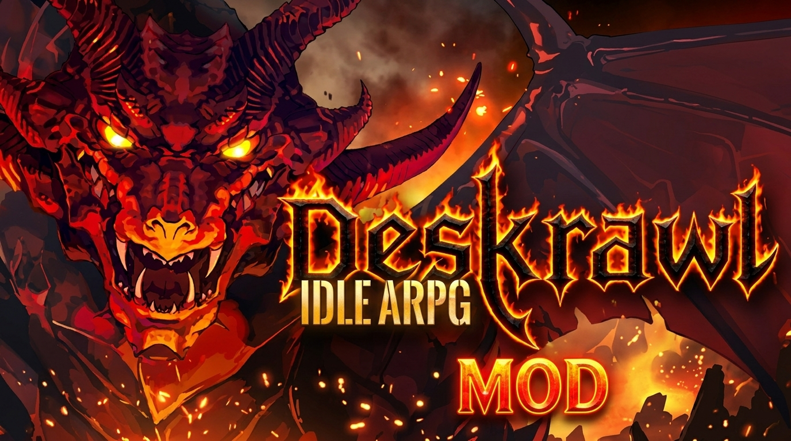

# ⚔️ Deskrawl: Idle ARPG - Ultimate QoL & Customization Mod Collection

  

  

  
  
  
  

  <b>⬇ DOWNLOAD THE MOD PACK ⬇</b>

  

  
  

  

> ⚔️ **Your complete toolkit for Deskrawl: Idle ARPG** — skip the grind, capture every enemy, and build your heroes without limits. Designed for **offline single-player** play. 🛡️ **NO MEMORY INJECTION** — this repository focuses on safe, client-side configuration tweaks and external tools. No aimbots, no game-breaking cheats.

## 📖 About the Game

**Deskrawl: Idle ARPG** is a desktop idle ARPG developed by **First Day Games** and published by First Day Games and Gamersky Games. It released on **September 28, 2026**, and plays at the bottom of your desktop while you work or relax.

Grind mobs, farm legendary loot, and capture enemies to serve you. Choose from a roster of heroes, mix gear, minions, and abilities to reach a godlike build. Your captured minions even haul the loot cart, so you never stop grinding.

**Key Game Features**:
- 🖥️ **Desktop Idle Gameplay** — Runs at the bottom of your screen
- ⚔️ **Hero Roster** — Multiple heroes with unique playstyles
- 🤖 **Minion Capture** — Capture enemies, even Bosses, to fight for you
- 🏘️ **Town Progression** — Grow your outpost into a thriving hub
- 🛒 **Steam Market Trading** — Trade equipment, materials, and minions with other players
- 🌀 **Mythic Realms** — Timed trials and escalating difficulty tiers

## ⚠️ IMPORTANT WARNING — READ BEFORE USING

**Deskrawl: Idle ARPG is primarily a single-player offline game, but it has a Steam Market component.**

| Enforcement Risk | Details |
|------------------|---------|
| **Single-Player Safe** | No competitive anti-cheat for offline play |
| **Steam Market Risk** | Trading cheated items on the Steam Market may violate Steam's Terms of Service |
| **This Repo** | Contains **NO memory injection**. Only client-side config tweaks and external companion tools |
| **Offline Only** | The trainer options are for **offline mode only** |

> ⚠️ **Important**: The game has no anti-cheat for offline play. However, using cheated items in the **Steam Market** can result in trade restrictions or account penalties. This repository focuses on **safe, offline QoL mods** that enhance your single-player experience. Always back up your saves.

## 🔒 Safety & Security

| Safety Feature | Description |
|----------------|-------------|
| **No Memory Injection** | Focus on external companion tools and config tweaks |
| **Offline Focused** | Designed for single-player progression |
| **No Network Code** | Mods contain no telemetry or online hooks |
| **Backup Recommended** | Always back up saves before installing mods |

## 🔥 Featured Mods

### 🎮 MoggyDay Trainer (+54 Features)

**Source:** MoggyDay Trainer | **Version:** v1.0.0 | **Updated:** October 18, 2026

A comprehensive external companion tool with 54 features for offline customization and testing.

**Features**:
- **Player**: God Mode, Infinite Health
- **Combat**: One Hit Kill, Super Damage, 100% Crit, Freeze Mobs, Instant Boss Spawn
- **Idle**: Auto-Attack Always On, Idle Speed Max, No Offline Cap, Instant Offline Claim, Skip Current Wave, Desktop Overlay Always Visible, Freeze Enemies On Bar
- **Economy**: Infinite Gold, Edit Gold, Gold Multiplier, Infinite Gems, Edit Gems, Free Upgrades
- **Loot**: 100% Drop Rate, Legendary Always Drops, Drop Multiplier, Max Gear Enchant
- **Capture**: Infinite Capture Chance, Instant Capture, Captured Army Immortal, Max Captured Slots
- **Progress**: XP Multiplier, Max Hero Level, No Prestige Loss, Instant Prestige Rewards
- **Unlocks**: Unlock All Heroes, Unlock All Skills, Unlock All Zones, Unlock All Item Slots, Unlock All Titles
- **Skills**: No Skill Cooldown, Max Skill Rank, Infinite Skill Points
- **Craft**: Instant Craft Gear, No Craft Cost
- **Items**: Infinite Inventory, Max Stack Size, Always Full Potion
- **Movement**: Super Speed
- **Stats**: Max Luck Stat, Edit Attack, Edit Defense
- **Time**: Freeze Time, Set Game Speed, Slow Motion
- **Misc**: Save Position, Load Position

**Installation**:
1. Download the trainer from the button above.
2. Extract to any folder.
3. Run the trainer as administrator.
4. Launch Deskrawl and activate features via hotkeys.

> ⚠️ **Note**: This is an external trainer. Use only in offline mode. Do not trade cheated items on the Steam Market.

### 🛠️ DTool Trainer (Console-Based)

**Source:** Game735 | **Build:** 25569292 | **Updated:** October 5, 2026

A console-style trainer that requires no Cheat Engine installation. It uses simple commands for customization.

**Features**:
- **God Mode** — `god on` / `god off`
- **One-Hit Kill** — `hit on` / `hit off`
- **Move Speed** — `ms on 2` (2x multiplier)
- **Attack Speed** — `as on 2` (2x multiplier)
- **Game Speed** — `gs on 2` (2x multiplier)
- **Drop Rarity** — `drop rarity` / `drop off`
- **Ancient Drops** — `drop ancient` / `drop off`
- **All Quality Drops** — `drop all` / `drop off`
- **Auto Next Wave** — `autonext on` / `autonext off`
- **Status** — `status` (show current effects)
- **Reset** — `reset` (disable all effects)

**Installation**:
1. Download the archive (approx. 27.51 MB).
2. Extract to any folder.
3. Run the trainer as administrator.
4. Type commands at the `deskrawl>` prompt.

> ⚠️ **Note**: The trainer warns that any online features (leaderboards, cloud saves) may trigger anti-cheat. Use only in offline mode.

### 🤖 XMODhub (1-Click Trainer)

**Source:** XMODhub | **Type:** External Trainer

A simple 1-click trainer interface that auto-hooks the game safely without complex Cheat Engine tables.

**Features**:
- **God Mode**
- **Infinite Health/Mana**
- **One-Hit Kills**
- **Super Speed**
- **Custom Attack Speed Multipliers**
- **Gold/EXP Multipliers**

**Installation**:
1. Download and launch the XMODhub desktop app.
2. Search for "Deskrawl: Idle ARPG" in the library.
3. Click "Play" to auto-hook the game.
4. Toggle cheats from the UI or via hotkeys.

## 🚀 QUICK START

### Method 1 — MoggyDay Trainer (Recommended)

1. **Download** the trainer from the button above.
2. **Extract** to any folder.
3. **Run** the trainer as administrator.
4. **Launch** Deskrawl and use the hotkeys to activate features.

### Method 2 — DTool Console Trainer

1. **Download** the archive.
2. **Extract** to any folder.
3. **Run** the trainer as administrator.
4. **Type** commands at the `deskrawl>` prompt.

### Method 3 — XMODhub

1. **Download** XMODhub from the official website.
2. **Search** for Deskrawl in the library.
3. **Click Play** to auto-hook the game.
4. **Toggle** cheats from the UI.

> ⚠️ **Antivirus warning?** This is a false positive because the tool reads game memory. Add the file to your exceptions list.

### 📁 Folder Structure

### ⚠️ Important Notes
- **Backup your saves** before using any trainer.
- **Admin rights** are required for full functionality.
- **Works with Steam version** of Deskrawl.
- **Compatible with game version 1.0.2b**.
- **Offline mode only** — do not use online.
- **Do not trade cheated items on the Steam Market**.
- **Add the tool folder to antivirus exclusions** to prevent false positives.

## ❓ FAQ

### ❓ Is this a cheat or trainer?
**Yes.** This repository contains external trainers for Deskrawl: Idle ARPG. They are designed for **offline single-player use** to skip the grind and test builds. They do not include aimbots or online cheats.

### ❓ Will I get banned?
**No, for offline play.** Deskrawl has no anti-cheat for offline mode. However, trading cheated items on the **Steam Market** may violate Steam's Terms of Service and result in trade restrictions.

### ❓ Does it work with the latest patch?
**Yes.** The trainers are updated for game version **1.0.2b** (October 13, 2026 patch).

### ❓ Does it work on Windows 11?
**Yes.** Fully compatible with Windows 10 and 11 (64-bit).

### ❓ What is the Steam Market risk?
Deskrawl allows trading equipment, materials, and minions on the **Steam Market**. If you use trainers to generate items and then trade them, Valve may flag your account for market manipulation. **Do not trade cheated items.**

### ❓ How to uninstall?
Delete the trainer folder. No registry changes are made.

### ❓ What if the trainer doesn't work?
- Run both game and trainer as administrator.
- Add tool folder to antivirus exclusions.
- Try launching the trainer before the game.
- Check game version matches trainer version.

## 🛠️ System Requirements

Based on official Steam data:

| Component | Minimum | Recommended |
|-----------|---------|-------------|
| **OS** | Windows 10 64-bit | Windows 11 64-bit |
| **Processor** | Intel Core i3 | Intel Core i5 |
| **RAM** | 4 GB | 16 GB |
| **GPU** | NVIDIA GeForce GT 730 / AMD Radeon R7 240 | NVIDIA GeForce GTX 660 / AMD Radeon R9 270 |
| **Storage** | 5 GB (game) + 100 MB (mods) | 10 GB (game) + 100 MB (mods) |

## 📢 Disclaimer

> **Fan-made trainer collection.** Not affiliated with Deskrawl: Idle ARPG developers, First Day Games, Gamersky Games, or any publisher.
>
> **Use at your own risk.** The author is not responsible for account bans, save corruption, crashes, or damage.
>
> **Offline mode only** — do not use trainers in online features or trade cheated items on the Steam Market.
>
> **Back up your saves before use!**

## 🌟 Support This Project

- ⭐ **Star** this repository
- 🔔 **Watch** for updates
- 🐞 **Report** issues
- 💬 **Share** with friends!

© 2026 • Deskrawl: Idle ARPG • QoL & Customization Mods
